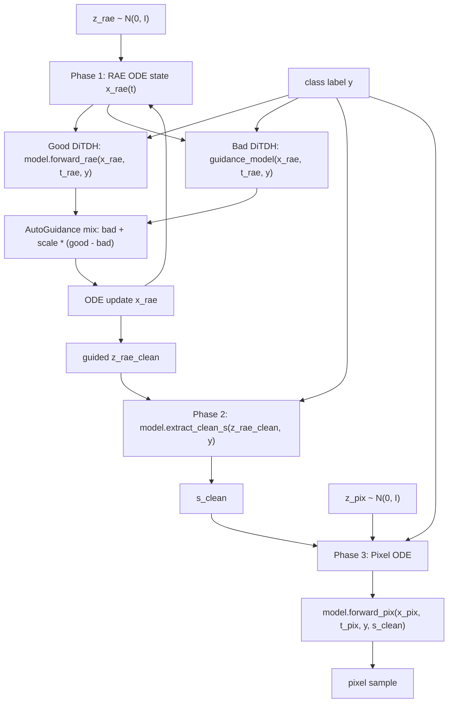

# AutoGuidance

## 目标

在 sequential PixelDDT 采样里，把 AutoGuidance 用在 DiTDH/RAE condition 生成阶段。Pixel Head 不参与 good/bad model 外推；它只接收已经 guided 的 clean RAE condition。

AutoGuidance 公式：

```text
D_w(x, t, y) = D_bad(x, t, y) + w * (D_good(x, t, y) - D_bad(x, t, y))
```

其中：

- `x` 是当前 RAE latent ODE state。
- `t` 是 RAE/DiTDH timestep。
- `y` 是同一个 class label condition。
- `D_good` 是主 PixelDDT 模型内部 frozen DiTDH。
- `D_bad` 是额外加载的 DiTDH guidance model。
- `w` 对应 `guidance.scale`，`w=1.0` 退化为 good-only。

对当前 6*768 free_layer 模型，`D_good` 来自原始训练/采样配置里的 `stage_2.params.stage2_ckpt`：

```text
/home/shihaoyang/data/pretrained/DiTs/Dinov2/wReg_base/ImageNet256/DiTDH-S_ep20/stage2_model.pt
```

## 模块边界

```text
configs/stage2/sampling/...AG.yaml
  声明 good DiTDH、bad DiTDH、guidance scale 和 interval。

src/sample_pix_ddt_project_free_layer.py
  采样入口。
  负责加载 PixelDDT checkpoint、实例化 bad DiTDH、读取 CLI override。

src/train_stage3_projcet_free_layer.py
  sequential sampler 所在文件。
  project_sample_ode_naive 负责 Phase 1/2/3 数据流和 AutoGuidance 混合。

src/stage2/models/PixelDDTv2_project_free_layer.py
  PixelDDT 模型定义。
  model.ddt 是 good DiTDH。
  forward_rae 运行 DiTDH RAE denoiser。
  extract_clean_s 从 guided clean RAE latent 抽取 Pixel Head condition。
  forward_pix 运行 Pixel Head。

ag_sweep.sh
  服务器实验入口。
  sweep bad DiTDH checkpoint 和 guidance scale。
```

## 数据流



## Sampler 接口

核心函数：

```python
project_sample_ode_naive(
    z_pix,
    z_rae,
    model,
    transport_pix,
    transport_rae,
    num_steps=50,
    cfg_scale=1.0,
    cfg_interval=(0.0, 1.0),
    guidance_method="cfg",
    guidance_model=None,
    ag_phase="condition",
    y=labels,
)
```

AutoGuidance 相关参数：

| 参数 | 类型 | 作用 |
| --- | --- | --- |
| `guidance_method` | `"cfg"` or `"autoguidance"` | 选择 CFG 或 AG。 |
| `cfg_scale` | `float` | CFG/AG 共用 scale 字段；AG 中是 `w`。 |
| `cfg_interval` | `(float, float)` | 只在指定 RAE timestep interval 内混合 good/bad 输出。 |
| `guidance_model` | `DiTwDDTHead` | bad DiTDH denoiser。AG 开启时必需。 |
| `ag_phase` | `"condition"` or `"rae"` | 当前两者等价，表示 AG 作用在 DiTDH/RAE condition path。 |
| `y` | `Tensor[B]` | class condition。AG 不拼 null label。 |

AG 分支内部调用：

```python
good_rae = model.forward_rae(x_rae, t_rae_batch, y)
bad_rae = guidance_model(x_rae, t_rae_batch, y)
model_out_rae = bad_rae + cfg_scale * (good_rae - bad_rae)
```

然后用 `model_out_rae` 更新 RAE ODE state。Pixel ODE 不做 AG 混合。

## Config 接口

采样 YAML：

```yaml
stage_2:
  target: stage2.models.PixelDDTv2_project_free_layer.PixelDDT
  params:
    stage2_ckpt: /home/shihaoyang/data/pretrained/DiTs/Dinov2/wReg_base/ImageNet256/DiTDH-S_ep20/stage2_model.pt
    stage2_config:
      input_size: 16
      patch_size: 1
      in_channels: 768
      hidden_size: [384, 2048]
      depth: [12, 2]
      num_heads: [6, 16]
      ...

guidance:
  method: autoguidance
  scale: 1.05
  t_min: 0.0
  t_max: 1.0
  ag_phase: condition
  guidance_model:
    ckpt: /home/shihaoyang/data/pretrained/DiTs/Dinov2/wReg_base/ImageNet256/DiTDH-S_ep14/stage2_model.pt
```

Compact `guidance_model` 规则：

- 如果 `guidance_model.target` 缺省，采样脚本会自动使用 `stage2.models.DDT.DiTwDDTHead`。
- `guidance_model.params` 会继承 `stage_2.params.stage2_config`。
- `guidance_model.ckpt` 只负责加载 bad DiTDH 权重。

显式写法也支持：

```yaml
guidance:
  guidance_model:
    target: stage2.models.DDT.DiTwDDTHead
    params:
      input_size: 16
      patch_size: 1
      in_channels: 768
      hidden_size: [384, 2048]
      depth: [12, 2]
      num_heads: [6, 16]
      ...
    ckpt: /home/shihaoyang/data/pretrained/DiTs/Dinov2/wReg_base/ImageNet256/DiTDH-S_ep14/stage2_model.pt
```

## CLI 接口

采样脚本入口：

```bash
torchrun --standalone --nnodes=1 --nproc_per_node=4 \
  src/sample_pix_ddt_project_free_layer.py \
  --config configs/stage2/sampling/ImageNet256/PixDDT_6x768_project_free_layer_2_false_pix_ts1_AG.yaml \
  --ckpt /home/shihaoyang/data/ckpts/PixDDTv2/.../checkpoints/ep-0000050.pt \
  --guidance-method autoguidance \
  --ag-phase condition \
  --ag-ckpt /home/shihaoyang/data/pretrained/DiTs/Dinov2/wReg_base/ImageNet256/DiTDH-S_ep14/stage2_model.pt \
  --cfg-scale 1.05 \
  --t-min 0.0 \
  --t-max 1.0
```

CLI override 优先级：

| CLI 参数 | 覆盖 YAML 字段 |
| --- | --- |
| `--guidance-method` | `guidance.method` |
| `--ag-phase` | `guidance.ag_phase` |
| `--ag-ckpt` | `guidance.guidance_model.ckpt` |
| `--cfg-scale` | `guidance.scale` |
| `--t-min` | `guidance.t_min` |
| `--t-max` | `guidance.t_max` |

## 实验矩阵

服务器 checkpoint 目录：

```text
/home/shihaoyang/data/pretrained/DiTs/Dinov2/wReg_base/ImageNet256
```

当前 sweep：

| 角色 | Checkpoint |
| --- | --- |
| good DiTDH | `DiTDH-S_ep20/stage2_model.pt`，由 `stage_2.params.stage2_ckpt` 加载 |
| bad DiTDH | `DiTDH-S_ep14/stage2_model.pt`，作为 AG guidance model |

Scale：

```text
2.50, 3.00, 3.50, 4.00
```

Interval：

```text
t_min=0.0, t_max=1.0
```

上一轮 `scale=1.00, 2.00, 3.00, 4.00, 5.00` 中，`scale=3.00` 最好，`4.00` 略回升，`5.00` 明显过强。当前 `ag_sweep.sh` 只保留 `ep14 as bad + ep20 as good` 的 AG scale sweep。

运行 6*768 AG scale sweep：

```bash
cd /home/shihaoyang/RAE
bash ag_sweep.sh
```

临时改 sweep 网格：

```bash
SCALES="2.50 3.00 3.50" bash ag_sweep.sh
```

## Pix TS Sweep

Pixel time shift 不放进 `ag_sweep.sh`。如果要在某个 AG scale 的基础上扫 `pix_ts`，使用专门的 `eval_pix_ts_sweep.py`，通过生成临时 YAML 修改：

```text
misc.time_dist_shift_dim = int(pix_ts ** 2 * misc.time_dist_shift_base)
```

推荐流程：

```text
1. 用 ag_sweep.sh 先确定较好的 AG scale。
2. 在 eval_pix_ts_sweep.py 中固定该 AG scale、AG config 和 bad DiTDH checkpoint。
3. 只让 eval_pix_ts_sweep.py 管理 pix_ts 列表和临时 YAML。
```

## 12*1152 后续实验

12*1152 不和 6*768 共用 `ag_sweep.sh`。当前使用独立入口：

```text
ag_sweep_1152.sh
configs/stage2/sampling/ImageNet256/PixDDT_12x1152_project_free_layer_1_3_5_7_DiTDHXL_pix_ts1_AG.yaml
```

原 12*1152 配置使用 DiTDH-XL 作为 frozen good DiTDH：

```text
/home/shihaoyang/data/pretrained/DiTs/Dinov2/wReg_base/ImageNet256/DiTDH-XL/stage2_model.pt
```

默认 bad guidance model 使用同架构 weaker checkpoint：

```text
/home/shihaoyang/data/pretrained/DiTs/Dinov2/wReg_base/ImageNet256/DiTDH-XL_ep80/stage2_model.pt
```

默认 `pix_ts=1`：

```text
misc.time_dist_shift_dim=4096
misc.time_dist_shift_base=4096
```

运行：

```bash
cd /home/shihaoyang/RAE
bash ag_sweep_1152.sh
```

如果 12*1152 Pixel Head checkpoint 的实际路径不同，用 `PIXEL_CKPT` 覆盖：

```bash
PIXEL_CKPT="/path/to/12x1152/checkpoints/ep-0000050.pt" bash ag_sweep_1152.sh
```

如果 bad 改用 DiTDH-S，则不能使用 compact guidance config，必须显式写 DiTDH-S architecture，因为 compact 写法会继承 good DiTDH-XL 的 `stage2_config`。

## 实现约束

- AG 不使用 null label。
- AG batch size 保持 `B`，不拼 `[cond; uncond]`。
- good/bad DiTDH 的 latent shape、prediction type、transport setting、time parameterization 必须一致。
- `pixel_only` 模型没有 DiTDH condition path，不能使用 AG。
- PixelDDT checkpoint 通过 `--ckpt` 加载，只提供 Pixel Head 权重；bad model checkpoint 通过 `guidance_model.ckpt` 或 `--ag-ckpt` 加载。

## 验证清单

- `python3 -m py_compile src/sample_pix_ddt_project_free_layer.py src/train_stage3_projcet_free_layer.py`
- `bash -n ag_sweep.sh`
- 如需重复 control，可手动设置 `SCALES="1.00"` 单跑。
- 6*768 主要 AG sweep 使用 `bad=DiTDH-S_ep14`。
- 12*1152 主要 AG sweep 使用 `bad=DiTDH-XL_ep80`。
