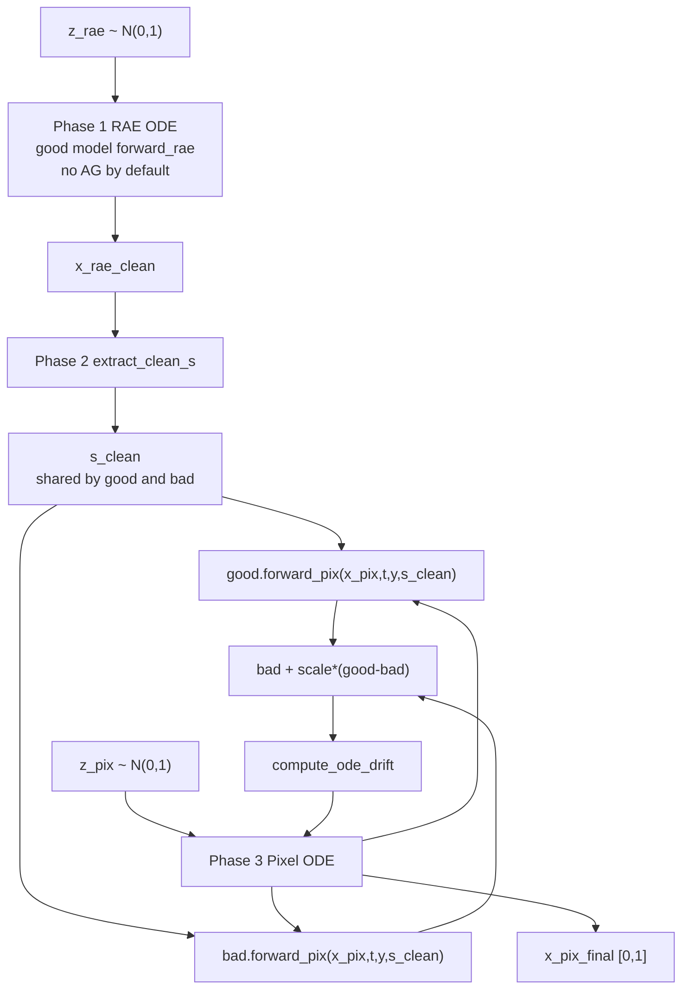
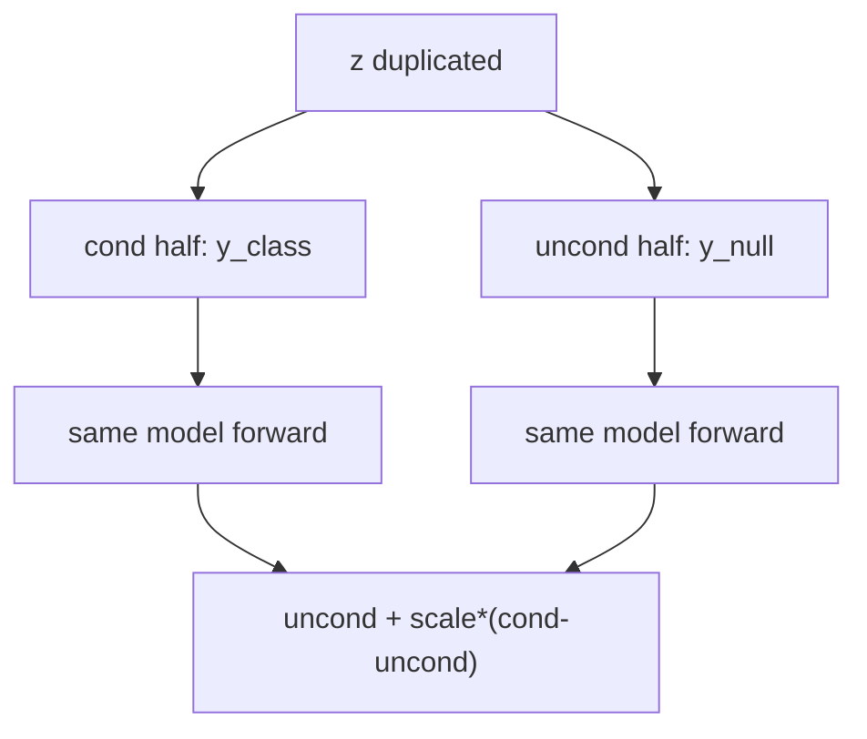
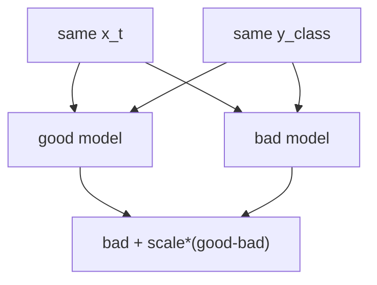
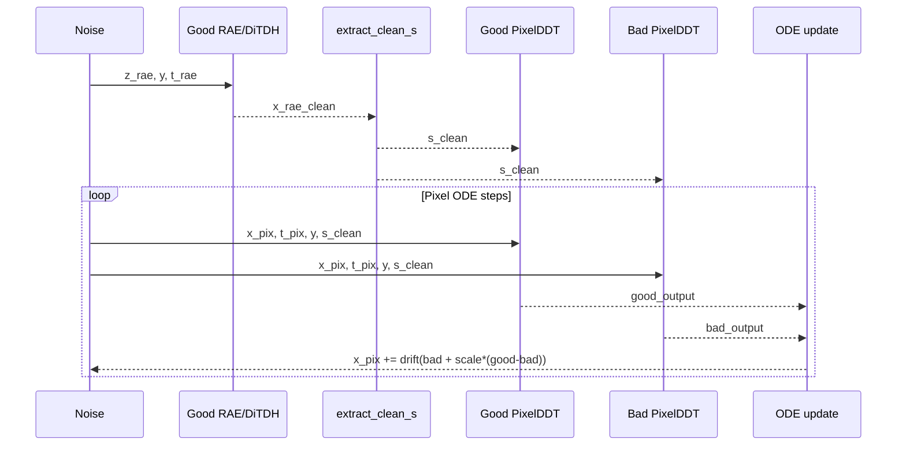

# AutoGuidance 实验计划

## 论文对齐

### AutoGuidance 要点

AutoGuidance 来自 Karras et al. 的 *Guiding a Diffusion Model with a Bad Version of Itself*。它不是用 unconditional branch 做方向，而是用一个同条件、较弱的 bad model 做负方向：

```text
guided_output = bad_output + w * (good_output - bad_output)
```

其中 `good_output` 和 `bad_output` 接收同一个 `x_t`、同一个 timestep、同一个条件 `y`。论文的动机是把 CFG 中纠缠的“条件对齐”和“质量提升”分开：bad model 代表较低质量/欠训练/小模型的预测，good - bad 更像质量改进方向，而不是 cond - uncond 的语义方向。

与 CFG 的差别：

| 方法 | 负方向来自 | 条件是否相同 | 是否需要训练 unconditional branch | 主要控制对象 |
|---|---|---|---|---|
| CFG | 同一个模型的 `y_null` 输出 | 否，`y_class` vs `y_null` | 是，通过 class dropout | 条件对齐 + 质量一起变 |
| AutoGuidance | bad model 的 `y_class` 输出 | 是，good/bad 都吃 `y_class` | 否，但需要 bad model | 更偏质量方向 |

因此在本 repo 里切换到 AG 时，不应该继续拼 `[y_class; y_null]` 当作核心逻辑。AG 第一版可以完全不走 `null_label=1000`，也不依赖 `null_s_clean`；它依赖的是一个输出形状、prediction type、数据范围都与 good model 一致的 guidance model。

### RAE 论文约束

RAE 论文把 VAE latent 替换为 DINO/SigLIP/MAE 等 representation encoder 的高维 latent，并配合训练出的 decoder。当前 repo 的 Stage 2 模型在 RAE latent 上使用 DiT/DDT 进行生成，关键特点是：

- RAE latent 形状是 `[B, 768, 16, 16]`，高维且语义强。
- 原始 RAE 采样是 latent diffusion：从 `z_rae` 去噪到 `x_rae_clean`，再由 RAE decoder 解码。
- 我们当前项目不是直接输出 RAE decoder 图像，而是串行改造为：
  1. RAE/DiTDH 先生成干净 latent；
  2. 从干净 latent 抽 `s_clean`；
  3. PixelDDT 用 `s_clean` 作为固定条件，直接在像素空间生成 `[B,3,256,256]`。

这意味着 AutoGuidance 有两个可能作用点：RAE latent 流和 Pixel 流。但当前 free_layer 训练里，RAE/DiTDH backbone 通常由 `stage2_ckpt` 加载并冻结；Pixel Head 才是主要训练对象。所以第一版实验应优先放在 Pixel Phase 3。

## 当前代码现状

### 已有 AG 支持：单流 RAE/DDT

`src/sample_ddp.py` 已经支持：

```python
guidance_method = guidance_config.get("method", "cfg")
if guidance_scale > 1.0 and guidance_method == "autoguidance":
    guid_model = instantiate_from_config(guid_model_config).to(device)
    guid_model_forward = guid_model.forward
...
model_kwargs["additional_model_forward"] = guid_model_forward
model_fn = model.forward_with_autoguidance
```

对应模型 `src/stage2/models/DDT.py` 里也已有：

```python
model_out = self.forward(x, t, y)
ag_model_out = additional_model_forward(x, t, y)
eps = ag_eps + cfg_scale * (eps - ag_eps)
```

这条路径说明 repo 原本理解了 AutoGuidance，但只接在单流 latent sampler 上。

### 当前主路径：sequential PixelDDT 只支持 CFG

我们当前使用的是：

- `src/sample_pix_ddt_project_free_layer.py`
- `src/train_stage3_projcet_free_layer.py::project_sample_ode_naive`
- `src/stage2/models/PixelDDTv2_project_free_layer.py`

采样脚本现在只读：

```python
guidance_scale = float(guidance_d.get("scale", 1.0))
using_cfg = guidance_scale > 1.0
```

然后只要 `scale > 1` 就执行 CFG batch doubling：

```python
z_pix = torch.cat([z_pix, z_pix], dim=0)
z_rae = torch.cat([z_rae, z_rae], dim=0)
y_cfg = torch.cat([y, y_null], dim=0)
```

`project_sample_ode_naive` 也只会在 Phase 1 调：

```python
model.forward_rae_with_cfg(...)
```

在 Phase 3 调：

```python
model.forward_pix_with_cfg(...)
```

因此当前 `guidance.method: autoguidance` 即使写进 YAML，也不会生效。

## 实验设计

### 第一版：Pixel Phase 3 AutoGuidance

第一版只改采样，不重新训练 good model。

```text
Phase 1: RAE ODE
  z_rae -> x_rae_clean
  默认不用 AG，保持当前条件 RAE 轨迹

Phase 2: Extract s_clean
  x_rae_clean -> s_clean
  只抽一次，作为 good/bad Pixel Head 的共同条件

Phase 3: Pixel ODE
  good_pix = good_model.forward_pix(x_pix, t_pix, y, s_clean)
  bad_pix  = bad_model.forward_pix(x_pix, t_pix, y, s_clean)
  guided   = bad_pix + ag_scale * (good_pix - bad_pix)
```

核心原因：如果 good/bad 两个 PixelDDT 都使用同一个冻结 `stage2_ckpt`，它们的 `forward_rae` 基本相同；Phase 1 AG 没有有效方向。Pixel Head 才是当前实验真正训练出的部分，bad checkpoint 的差异会体现在 Pixel 输出上。



### bad model 选择

bad model 必须满足：

- `stage_2.target` 与 good model 兼容，最好同为 `stage2.models.PixelDDTv2_project_free_layer.PixelDDT`。
- 输出 shape 与 good 完全一致。
- `transport.prediction` 一致。当前 Pixel 流是 `prediction: data`，RAE 流是 `prediction: velocity`。
- Pixel 输入范围一致：当前 project/free_layer 版本输出按 `[0,1]` clamp，不做 `(x+1)/2`。
- `rae_inject_layers`、`rae_inject_final_layer`、`use_y_embedder` 等结构参数必须能加载 guidance checkpoint。

推荐优先级：

| bad model | 优点 | 风险 |
|---|---|---|
| 同一次训练的早期 epoch EMA | 架构完全一致，最稳 | bad 可能太差或太接近，需要 sweep |
| 同架构但更少训练步 checkpoint | 符合 AG 论文“less-trained”设定 | 需要保留历史 ckpt |
| 更小 PixelDDT head | 更像论文中的 smaller model | 需要单独训练，且 `forward_pix` shape 要匹配 |
| 普通 DiTDH-S RAE guidance model | 已有 AG YAML 类似写法 | 只能指导 RAE latent，不能直接指导 Pixel Phase 3 |

第一版建议使用同架构早期 checkpoint，例如：

```yaml
guidance:
  method: autoguidance
  scale: 1.2
  t_min: 0.0
  t_max: 1.0
  ag_phase: pixel
  guidance_model:
    target: stage2.models.PixelDDTv2_project_free_layer.PixelDDT
    params:
      # 必须与 good model architecture 对齐
    ckpt: /path/to/earlier-or-weaker/ep-xxxx.pt
```

## 关键代码位置与计划改动

### 1. `configs/stage2/sampling/...yaml`

当前：

```yaml
guidance:
  method: 'cfg'
  scale: 1.0
  t_min: 0.0
  t_max: 1.0
```

计划新增一个 AG sampling config，避免覆盖 CFG baseline：

```text
configs/stage2/sampling/ImageNet256/PixDDT_small_v2_lora_project_free_layer_AG.yaml
```

新增字段：

```yaml
guidance:
  method: autoguidance
  scale: 1.2
  t_min: 0.0
  t_max: 1.0
  ag_phase: pixel
  guidance_model:
    target: stage2.models.PixelDDTv2_project_free_layer.PixelDDT
    params:
      # 与 good model 一致，或明确的小 bad model 架构
    ckpt: /path/to/bad_model.pt
```

### 2. `src/sample_pix_ddt_project_free_layer.py`

现有读取 guidance 的位置在 `# ---- Guidance settings ----`。需要改成：

```python
guidance_method = guidance_d.get("method", "cfg")
guidance_scale = float(guidance_d.get("scale", 1.0))
ag_phase = guidance_d.get("ag_phase", "pixel")
```

当 `guidance_method == "autoguidance" and guidance_scale > 1.0`：

1. 从 `guidance_d["guidance_model"]` instantiate bad model。
2. 加载 bad model checkpoint。注意 `instantiate_from_config` 对 `stage_2.ckpt` 是否自动加载要检查；当前 good model 是脚本手动用 `--ckpt` 加载的，所以 guidance model 也建议脚本显式加载，避免 YAML 里的 `ckpt` 被忽略。
3. 不做 CFG 的 `[cond; uncond]` doubling。
4. 调用：

```python
project_sample_ode_naive(
    z_pix,
    z_rae,
    model,
    guidance_model=guid_model,
    guidance_method="autoguidance",
    ag_phase="pixel",
    cfg_scale=guidance_scale,
    cfg_interval=(t_min, t_max),
    y=y,
)
```

CFG 仍保留原逻辑，作为 baseline。

### 3. `src/train_stage3_projcet_free_layer.py::project_sample_ode_naive`

该函数是实际三阶段采样器，需要新增参数：

```python
guidance_method="cfg"
guidance_model=None
ag_phase="pixel"
```

内部判断：

```python
using_guidance = cfg_scale > 1.0
using_cfg = using_guidance and guidance_method == "cfg"
using_ag = using_guidance and guidance_method == "autoguidance"
```

#### Phase 1

第一版默认不做 AG：

```python
model_out_rae = model.forward_rae(x_rae, t_rae_batch, y)
```

可选扩展：

```python
if using_ag and ag_phase in ("rae", "both"):
    good = model.forward_rae(x_rae, t_rae_batch, y)
    bad = guidance_model.forward_rae(x_rae, t_rae_batch, y)
    model_out_rae = apply_ag(good, bad, t_rae_batch)
```

但这只有在 good/bad 的 RAE denoiser 确实不同的时候才有意义。否则只是多跑一次相同 frozen DiTDH。

#### Phase 2

第一版使用 good model 的 RAE trajectory 和 good model 的 extractor：

```python
s_clean = model.extract_clean_s(x_rae_clean, y)
```

不建议第一版用 bad model 抽 `s_clean`，因为 Pixel Head 训练时看到的是 good/current model 风格的 `s_clean`。AG 的差异应先限制在 Pixel prediction 上。

#### Phase 3

核心 AG 混合：

```python
good_out_pix = model.forward_pix(x_pix, t_pix_batch, y, s_clean)
bad_out_pix = guidance_model.forward_pix(x_pix, t_pix_batch, y, s_clean)
model_out_pix = apply_autoguidance(
    good_out_pix,
    bad_out_pix,
    t_pix_batch,
    cfg_scale,
    cfg_interval,
    channels=model.in_channels,
)
```

辅助函数：

```python
def apply_autoguidance(good_out, bad_out, t, scale, interval, channels):
    good_eps = good_out[:, :channels]
    bad_eps = bad_out[:, :channels]
    rest = good_out[:, channels:]
    mask = ((t >= interval[0]) & (t <= interval[1])).view(-1, *[1] * (good_eps.ndim - 1))
    guided_eps = torch.where(mask, bad_eps + scale * (good_eps - bad_eps), good_eps)
    return torch.cat([guided_eps, rest], dim=1) if rest.shape[1] > 0 else guided_eps
```

注意：这里的变量名沿用旧代码的 `eps` 习惯，但 Pixel transport 当前可能是 `prediction=data`。实现上应对“模型输出的前 `in_channels`”做 AG，而不是假设它一定是 epsilon。

### 4. `src/stage2/models/PixelDDTv2_project_free_layer.py`

模型里已经有 `forward_with_autoguidance`，但这是 joint forward 接口：

```python
forward_with_autoguidance(self, x_pix, x_rae, t_pix, t_rae, y, ...)
```

sequential sampler 不适合直接用它，因为 sampler 已经拆成：

- `forward_rae`
- `extract_clean_s`
- `forward_pix`

因此第一版不需要强改模型类。更清晰的做法是在 sampler 中组合 good/bad 的 phase-specific output。

后续如果想整理接口，可以新增：

```python
forward_rae_with_autoguidance(...)
forward_pix_with_autoguidance(...)
```

但不作为第一版必要项。

## 数据流对比

### 当前 CFG 数据流



### 计划 AG 数据流



### 放到 RAE-Pixel 串行架构里



## 实验矩阵

第一轮小 sweep：

| 实验 | method | bad model | scale | Phase 1 | Phase 3 |
|---|---|---|---|---|---|
| baseline | cfg | none | 1.0 | no guidance | no guidance |
| CFG baseline | cfg | none | 1.2 / 1.5 / 2.0 | current CFG | current CFG |
| AG-early | autoguidance | early same-arch ckpt | 1.05 / 1.1 / 1.2 / 1.4 | no AG | AG |
| AG-weak | autoguidance | intentionally weaker PixelDDT | 1.05 / 1.1 / 1.2 | no AG | AG |
| AG-both optional | autoguidance | different RAE + Pixel model | TBD | AG | AG |

建议先用 1k 或 5k samples 看图和粗 FID，再跑 50k FID。AutoGuidance 的 scale 通常不应照搬 CFG scale；它的方向不是 cond-uncond，scale 过大可能导致过锐、过饱和或偏离 Pixel Head 的训练分布。

## 风险与检查项

- **bad model 太接近 good**：`good - bad` 很小，AG 几乎无效。
- **bad model 太差**：方向可能不稳定，scale 稍大就崩。
- **Phase 1 AG 可能无效**：如果 RAE/DiTDH backbone 相同且冻结，good/bad `forward_rae` 输出相同。
- **guidance_model ckpt 加载**：需要明确 checkpoint key 是 `ema`、`model` 还是 raw state dict，并与 good model 加载逻辑一致。
- **DDP 显存翻倍**：AG 每个 Pixel ODE step 要多跑一次 bad model；但不需要 CFG batch doubling。若 batch 不翻倍，计算量约为两次 model forward，显存可能比 CFG 更友好但耗时接近。
- **s_clean 分布**：第一版只用 good `s_clean`，避免 bad extractor 改变 Pixel 条件分布。
- **prediction type 命名**：代码里的 `eps` 只是历史变量名。Pixel 流是 `prediction=data` 时，AG 仍对 model raw output 混合，再交给 `compute_ode_drift`。

## 最小落地顺序

1. 保留 CFG baseline 不动，新建 `_AG.yaml`。
2. 在 `sample_pix_ddt_project_free_layer.py` 增加 autoguidance 分支和 guidance model 加载。
3. 在 `project_sample_ode_naive` 增加 `guidance_method/guidance_model/ag_phase` 参数。
4. 只实现 `ag_phase="pixel"`。
5. 用小 batch、少步数 smoke test：

```bash
torchrun --standalone --nnodes=1 --nproc_per_node=1 \
  src/sample_pix_ddt_project_free_layer.py \
  --config configs/stage2/sampling/ImageNet256/PixDDT_small_v2_lora_project_free_layer_AG.yaml \
  --ckpt /path/to/good.pt \
  --sample-dir /tmp/ag_smoke \
  --num-fid-samples 16 \
  --per-proc-batch-size 4 \
  --num-steps 4 \
  --precision fp32 \
  --label-sampling random
```

6. 固定 seed 对比：
   - CFG scale 1.0
   - CFG scale 若干
   - AG scale 若干
7. 确认输出无 NaN、范围正常、图像没有明显崩坏后，再跑 FID。

## 参考

- AutoGuidance paper: arXiv:2406.02507, *Guiding a Diffusion Model with a Bad Version of Itself*.
- RAE paper: arXiv:2510.11690, *Diffusion Transformers with Representation Autoencoders*.
- Existing single-stream AG implementation: `src/sample_ddp.py`, `src/stage2/models/DDT.py`.
- Current sequential sampler: `src/train_stage3_projcet_free_layer.py::project_sample_ode_naive`.
- Current project sampler script: `src/sample_pix_ddt_project_free_layer.py`.
- Current PixelDDT phase methods: `src/stage2/models/PixelDDTv2_project_free_layer.py::forward_rae`, `extract_clean_s`, `forward_pix`.
