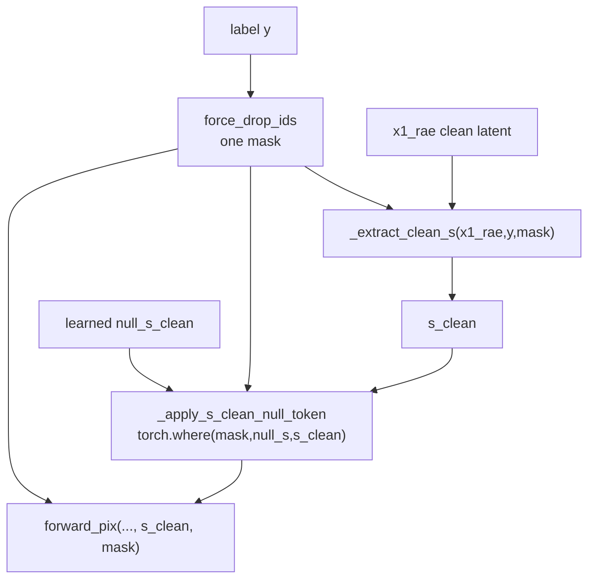
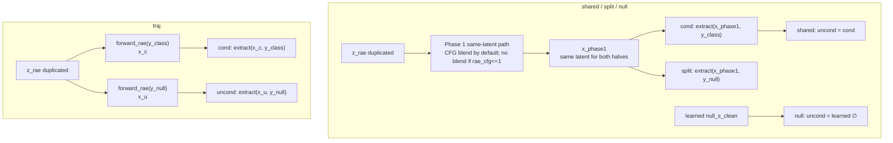

# CFG s_clean 方法说明

## 总览

```text
Phase 1  RAE ODE       纯噪声 z_rae → DiTDH 去噪 → 干净 DINOv2 latent x_rae_clean [B,768,16,16]
Phase 2  提取条件        x_rae_clean → DiTDH 12 层编码器 → 瓶颈特征 s_clean [B,256,384]
Phase 3  Pixel ODE      纯噪声 z_pix → Pixel Head（固定条件 s_clean）→ 图像 [B,3,256,256]
```

两条流的时间步完全解耦、独立运行。Pixel Head 把 `s_clean` 当作固定条件去噪。CFG（classifier-free guidance）只在采样时施加，训练负责的是“让模型学会无条件分支”，为采样的 CFG 准备好 null 类与 null s_clean。

---

## 一、Training

### 模型规模与参数

| 模块 | 配置 | 状态 |
|---|---|---|
| Pixel Head | depth=6, hidden_size=768, num_heads=12, ~67M | 可训练 |
| DiTDH-S backbone | 12 层编码器(384) + 2 层解码器(2048), ~197M | **冻结** |

Pixel Head 架构开关：`use_swiglu=true`、`use_rope=true`、`use_rmsnorm=true`、`use_qknorm=false`、`use_adaln_zero=true`、`use_y_embedder=true`、`use_lora=false`。

**注入层 `rae_inject_layers=[2]`、`rae_inject_final_layer=false`**：6 层 Pixel Head 里**只有第 2 层吃 s_clean**，其余 5 层用 `t+y`（时间步 + 类别标签）做 AdaLN 条件。

### RAE 与 CFG

RAE backbone（DiTDH-S）是冻结的。训练中它有两个用途：

- 用 `x1_rae`（真实图像经 Stage-1 RAE/DINOv2 编码得到的干净 latent）提取 `s_clean`，作为 Pixel Head 条件。
- 额外跑一条 RAE denoising branch 并计算 `loss_rae`。当前配置 `use_lora=false`，RAE/DiTDH 参数冻结且 forward 在 `torch.no_grad()` 下，所以这条 loss 不更新 RAE backbone；主要训练对象仍是 Pixel Head + `null_s_clean`。

RAE 流是否在采样时开 CFG，是采样侧的选择（见第二部分），与训练无关。

### s_clean 如何置空

`use_s_clean_null_token=true` 时，模型注册一个**可学习参数**：

```python
self.null_s_clean = nn.Parameter(torch.zeros(1, 256, 384))   # 零初始化，但 requires_grad=True
```

- **零只是初始化**，不是固定常量；它会被优化器一路更新、逐渐学成一个真正的“无条件 s_clean”（思路同 AdaLN-Zero）。只有 DiTDH backbone 被冻结，`null_s_clean` 不在其内，照常训练。

训练 forward 用**同一个** `force_drop_ids` 同步驱动三处置空：

```python
force_drop_ids = sample_cfg_drop_ids(y)                       # 采样一次，三处共用
s_clean = extract_clean_s(x1_rae, y, force_drop_ids)         # ① 编码器里 y → y_null
s_clean = where(force_drop_ids, null_s_clean, s_clean)       # ② 整条 s_clean → ∅（按样本替换）
imgs    = forward_pix(x_pix, t_pix, y, s_clean, force_drop_ids)  # ③ Pixel Head 的 y_embedder y → y_null
```

三者严格同步，所以**被 drop 的样本同时丢掉类别标签和 RAE 语义条件**，对应真正的无条件分支，与 y_embedder 的第 1000 号空类完全对称。
`where(...)` 每一步都执行（即使该 micro-batch 无人被 drop），保证 `null_s_clean` 每步都在计算图里、拿得到梯度。

对应代码：

- `null_s_clean`：`src/stage2/models/PixelDDTv2_project_free_layer.py:238-243`
- dropout mask：`_sample_cfg_drop_ids`，`src/stage2/models/PixelDDTv2_project_free_layer.py:391-395`
- null token 与 `torch.where`：`src/stage2/models/PixelDDTv2_project_free_layer.py:397-415`
- clean bottleneck 提取：`_extract_clean_s` / `extract_clean_s`，`src/stage2/models/PixelDDTv2_project_free_layer.py:450-481`
- training forward 同步置空：`src/stage2/models/PixelDDTv2_project_free_layer.py:610-631`



### 训练调度

两条流配置不同：

- Pixel transport：`prediction=data`、`loss_weight=velocity`、`time_dist_type=logit-normal_0.8_0.8`。
- RAE transport：`prediction=velocity`、`loss_weight=null`、`time_dist_type=logit-normal_0_1`。
- pixel/RAE 两条流各自的 time_shift（`misc.time_dist_shift_dim` / `misc_rae.time_dist_shift_dim`）；从头训（只加载冻结 backbone，pixel head 随机初始化）。

对应配置见 `configs/stage2/training/PixelDDT_free_layer_2_wo_lora_w_y_embed_adaln_zero_6_768_DiTDHS_null_s_clean.yaml:66-108`。

---

## 二、Sampling

开 CFG 时，`z_pix`、`z_rae`、`y` 都扩成 `[cond; uncond]`，`y=[y_class, y_null]`，最终
`guided = uncond + scale · (cond − uncond)`。

### 两路 CFG（可独立设强度）

CFG 有**两个**施加点，强度可解耦：

| 施加点 | 函数 | 强度参数 | 作用 |
|---|---|---|---|
| Phase 1（RAE 流） | `forward_rae_with_cfg` | `--rae-cfg-scale` | CFG 引导 RAE 去噪 → 更贴类别的 latent → 更干净的 s_clean |
| Phase 3（Pixel 流） | `forward_pix_with_cfg` | `--cfg-scale`（pix） | Pixel 空间的 classifier-free guidance |

- 默认 `--rae-cfg-scale` 不传 → 两路耦合（rae = pix = `--cfg-scale`），等于一个 scale 同时驱动两条流。
- `--rae-cfg-scale 1.0` → **RAE 流关 CFG**：Phase 1 退化为一次自然条件去噪（两半都喂 y_class，得到同一张未锐化的条件 latent），Pixel 流仍按 `--cfg-scale` 做 CFG。
- **CFG 区间** `cfg_interval=(t_min, t_max)`：只在该时间区间内施加 guidance（t=1 噪声端，t=0 干净端），两路共用同一区间。

> Pixel Head 里只有第 2 层吃 s_clean、其余 5 层吃 y，所以 Pixel-CFG 的大部分其实是标准的 **y-CFG**（类别标签），只有第 2 层走 **s_clean-CFG**。下面四种模式只改变第 2 层 uncond 半边的 s_clean。

对应代码：

- 独立采样脚本读取 `--cfg-scale` / `--t-min` / `--t-max` / `--s-clean-cfg-mode`：`src/sample_pix_ddt_project_free_layer.py:239-257`
- 采样脚本把 `z_pix/z_rae/y` 扩成 `[cond; uncond]` 并调用 `project_sample_ode_naive`：`src/sample_pix_ddt_project_free_layer.py:317-338`
- CLI 选项 `--s-clean-cfg-mode` 与 `--rae-cfg-scale`：`src/sample_pix_ddt_project_free_layer.py:397-405`
- RAE-CFG 是否开启、`rae_cfg_scale` 解耦、`traj` 特判：`src/train_stage3_projcet_free_layer.py:176-219`
- Phase 1 RAE ODE：`src/train_stage3_projcet_free_layer.py:253-287`
- Phase 2 四种 `s_clean_cfg_mode` 分支：`src/train_stage3_projcet_free_layer.py:289-324`
- Phase 3 Pixel ODE：`src/train_stage3_projcet_free_layer.py:326-350`
- CFG mask 公式在模型 forward 中实现：RAE `src/stage2/models/PixelDDTv2_project_free_layer.py:639-658`，Pixel `src/stage2/models/PixelDDTv2_project_free_layer.py:660-678`

CFG 混合真实实现如下（两路结构相同，区间外返回 cond）：

```python
mask = ((t_half >= guid_t_min) & (t_half <= guid_t_max))
half_eps = torch.where(
    mask,
    uncond_eps + cfg_scale * (cond_eps - uncond_eps),
    cond_eps,
)
```

`s_clean` 只进入被注入的 Pixel block。当前 `[2]` 配置的真实分支在 `src/stage2/models/PixelDDTv2_project_free_layer.py:563-588`：

```python
s_trans_rae_list = [proj(silu(t_pix + s_clean)) for proj in self.s_projectors]
s_trans_t_only_list = [proj(silu(t_pix + y_emb)) for proj in self.s_projectors]

if self._inject_set is None or global_i in self._inject_set:
    c = s_trans_rae_list[si]      # layer 2 only in current config
else:
    c = s_trans_t_only_list[si]   # other layers use t+y
```

### 四种 s_clean 构造（`--s-clean-cfg-mode`）

cond 半边的 s_clean 总是 `extract(条件 latent, y_class)`；四种模式区别在**uncond 半边的 s_clean 怎么来**。下表里的 `x_phase1` 指 Phase 1 输出的同一个条件 latent：默认是 RAE-CFG 混合后的 latent；若 `--rae-cfg-scale 1.0`，则是不混合、两半同喂 `y_class` 得到的自然条件 latent。

| 模式 | cond s_clean | uncond s_clean | uncond 与 cond 同一张图? | 需 null token |
|---|---|---|---|---|
| `shared` | extract(x_phase1, y_class) | = cond（直接复用） | 是 | 否 |
| `split` | extract(x_phase1, y_class) | extract(**x_phase1**, **y_null**) | 是（同 latent，只换 label） | 否 |
| `traj` | extract(**x_c**, y_class) | extract(**x_u**, **y_null**) | **否（两张不同的图）** | 否 |
| `null` | extract(x_phase1, y_class) | **learned `null_s_clean`（∅）** | —（不经 latent） | 是 |

逐个说明：

- **`shared`**：uncond 直接复用 cond 的 s_clean。第 2 层的 cond/uncond 条件相同，s_clean 对 CFG 方向零贡献，Pixel-CFG 实际只来自 y。最弱的 uncond。

- **`split`**：cond 和 uncond 用**同一个** Phase-1 latent（默认是 RAE-CFG 后的 latent；RAE-CFG 关时是自然条件 latent），只是 extract 时一个 y_class、一个 y_null。uncond 仍带着该图的空间/语义内容，只是丢了类别条件(同一张图、去掉类别)。不需要 null token，任意 ckpt 可用。

- **`traj`**：Phase 1 **不做 CFG 混合**，让 `[y_class, y_null]` 两半从同一噪声各自演化成两个**不同**的干净 latent：
  ```
  x_c = RAE-ODE(z_rae, y_class, 无CFG)   → s_clean_cond   = extract(x_c, y_class)
  x_u = RAE-ODE(z_rae, y_null,  无CFG)   → s_clean_uncond = extract(x_u, y_null)
  ```
  cond/uncond 的 s_clean 来自**两张不同的图**（不是同一张图的两种条件），且 cond latent 未经 RAE-CFG。不需要 null token、任意 ckpt 可用。

- **`null`**：uncond 直接用训练学到的 `null_s_clean`（真正的“空白” ∅）。cond 仍用 Phase 1 的条件 latent 提取。**需要 `use_s_clean_null_token=true` 训练出来的 ckpt**（否则缺参数）。这是与 y_embedder 第 1000 号空类对称的的无条件条件。


