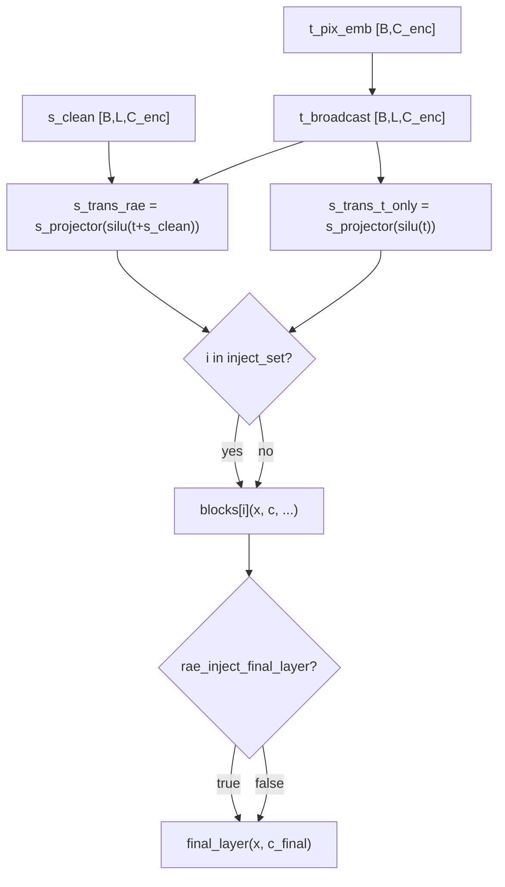

# Free Layer Injection 计划

## 核心改动分析

当前 `forward_pix` 中对所有 `depth=16` 个 Pixel Block 均传入同一个 `s_trans`（包含 `s_clean`）：

```python
# 当前：每层都注入
for i in range(self.depth):
    x_pix_emb = self.blocks[i](x_pix_emb, s_trans, feat_rope=self.feat_rope)
```

目标：在 `__init__` 接收两个新参数，`forward_pix` 根据配置决定每层和 `final_layer` 是否注入 RAE 特征。

## 两个新配置字段

| 字段 | 类型 | 含义 |
|------|------|------|
| `rae_inject_layers` | `list \| null` | 控制 16 个主 Block 中哪些注入。`null` = 全注入；`[]` = 全不注入；`[0,4,8,12]` = 仅这几层 |
| `rae_inject_final_layer` | `bool` | 独立控制 `final_layer` 是否注入。`true` = 注入；`false` = 不注入 |

## 数据流（free_layer）



## 需要创建的 6 个文件

### 1. `src/stage2/models/PixelDDTv2_project_free_layer.py` (核心改动)
- 复制自 [`src/stage2/models/PixelDDTv2_project.py`](src/stage2/models/PixelDDTv2_project.py)
- `__init__` 增加两个参数：
  - `rae_inject_layers: list = None`
  - `rae_inject_final_layer: bool = True`
- 修改 `forward_pix`：预先计算 `s_trans_rae` 和 `s_trans_t_only`，逐层选择，`final_layer` 由 `rae_inject_final_layer` 决定

```python
t_broadcast    = t_pix_emb.unsqueeze(1).repeat(1, s_clean.shape[1], 1)
s_trans_t_only = self.s_projector(nn.functional.silu(t_broadcast))
s_trans_rae    = self.s_projector(nn.functional.silu(t_broadcast + s_clean))

for i in range(self.depth):
    c = s_trans_rae if (self._inject_set is None or i in self._inject_set) else s_trans_t_only
    x_pix_emb = self.blocks[i](x_pix_emb, c, feat_rope=self.feat_rope)

c_final = s_trans_rae if self.rae_inject_final_layer else s_trans_t_only
x_pix_emb = self.final_layer(x_pix_emb, c_final)
```

### 2. `configs/stage2/training/PixelDDTv2_small_lora_project_free_layer.yaml`
- 复制自 [`configs/stage2/training/PixelDDTv2_small_lora_project.yaml`](configs/stage2/training/PixelDDTv2_small_lora_project.yaml)
- `stage_2.target` → `stage2.models.PixelDDTv2_project_free_layer.PixelDDT`
- `stage_2.params` 增加：
  ```yaml
  rae_inject_layers: [0, 4, 8, 12]   # 示例，可自行修改
  rae_inject_final_layer: true
  ```

### 3. `configs/stage2/sampling/ImageNet256/PixDDT_small_v2_lora_project_free_layer.yaml`
- 复制自 [`configs/stage2/sampling/ImageNet256/PixDDT_small_v2_lora_project.yaml`](configs/stage2/sampling/ImageNet256/PixDDT_small_v2_lora_project.yaml)
- 同上修改 `target` + 添加两个新字段（与训练 yaml 保持完全一致）

### 4. `src/train_stage3_projcet_free_layer.py`
- 与 [`src/train_stage3_projcet.py`](src/train_stage3_projcet.py) 完全一致（训练逻辑无需改动，模型通过 yaml target 加载）

### 5. `src/sample_pix_ddt_project_free_layer.py`
- 与 [`src/sample_pix_ddt_project.py`](src/sample_pix_ddt_project.py) 完全一致

### 6. `retry_train_stage3_project_free_layer.sh`
- 复制自 [`retry_train_stage3_project.sh`](retry_train_stage3_project.sh)，修改：
  - `EXPERIMENT_NAME="PixDDT_small_v2_project_free_layer"`
  - `CKPT_DIR="/home/shihaoyang/data/ckpts/${EXPERIMENT_NAME}/checkpoints"`
  - `--results-dir /home/shihaoyang/data/ckpts/PixDDTv2`
  - `train_stage3_projcet.py` → `train_stage3_projcet_free_layer.py`
  - 训练/采样 config 指向新 `_free_layer.yaml`
  - 采样脚本 `sample_pix_ddt_project.py` → `sample_pix_ddt_project_free_layer.py`
  - log 文件名更新

## 配置语义示例

| `rae_inject_layers` | `rae_inject_final_layer` | 效果 |
|---|---|---|
| `null` | `true` | 与 _project 完全一致（全注入）|
| `[]` | `false` | 彻底无注入 |
| `[0, 4, 8, 12]` | `true` | 第 0/4/8/12 Block + final_layer 注入 |
| `[0, 4, 8, 12]` | `false` | 仅第 0/4/8/12 Block 注入，final_layer 不注入 |
