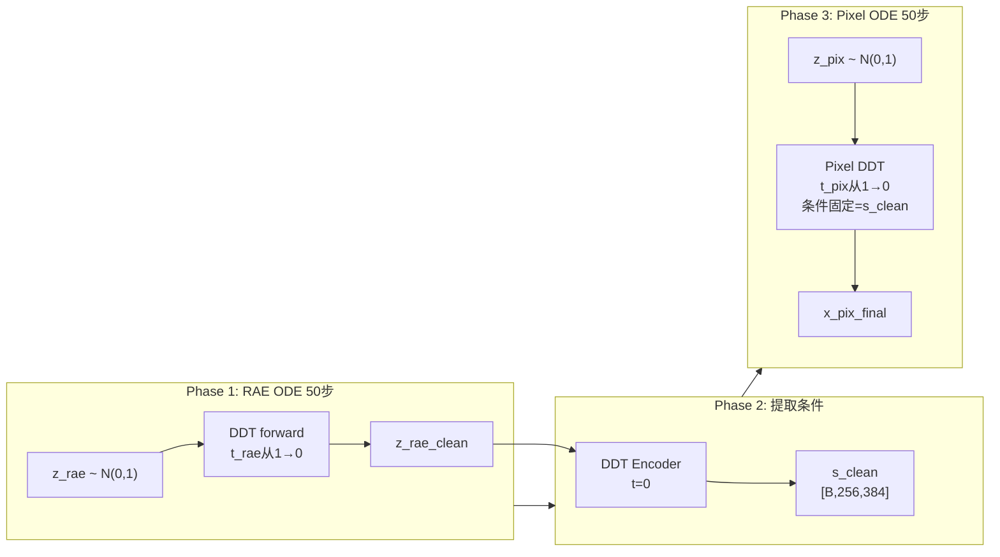

# Sequential RAE → Pixel 大作业实现计划

## 核心架构变化

**现在（并行）：** 每个 `s` 时间步，RAE 和 Pixel 同步运行，RAE 当前噪声预测结果提供条件

**Project（串行）：**

```
Phase 1: RAE ODE (50步)  z_rae_noise → ... → z_rae_clean
Phase 2: 提取条件        z_rae_clean → DDT encoder(t=0) → s_clean [B, 256, 384]
Phase 3: Pixel ODE (50步) z_pix_noise → ... → x_pix (固定用 s_clean 作条件)
```




## 关键实现决策

### 训练逻辑（保证训练=推理一致）

训练时 Pixel 损失用**干净** `x1_rae` 在 `t=0` 提取的 `s_clean` 作条件（不再用 noisy `xt_rae`）：

- Pixel loss: `model(xt_pix, t_pix, s_clean from x1_rae@t=0)` → 像推理 Phase 3
- RAE loss: `model_rae(xt_rae, t_rae)` → 像推理 Phase 1（小权重辅助损失）
- `t_pix` 和 `t_rae` 各自独立从 `logit-normal(0,1)` 采样（不再共用 `t_ori`）

### 恢复到原始版本（去掉 "Pro" 改动）

- `x_pix = images` （[0,1]，不做 `2*images-1`）
- 保存时 `samples.clamp(0, 1)`（不做 `(x+1)/2`）
- `compute_ode_drift` 中 DATA 类型：`/ sigma_t`（无 `clamp(min=0.05)`）
- `compute_stream_loss` 中 DATA 类型：同上无 clamp
- transport 参数：不手动设 `train_eps=0, sample_eps=0`（恢复默认 `1e-3`）
- 不 hardcode `logit-normal_0_1`，直接读 yaml

### Time shift 解耦

训练脚本的 `time_dist_shift_pix` 和 `time_dist_shift_rae` 计算逻辑保留（由 yaml 中的 `misc.time_dist_shift_dim/base` 决定），但两个 transport 的 `t` 完全独立，不再共享 `t_ori`。

---

## 文件清单及改动

### 1. `[src/stage2/models/PixelDDTv2_project.py](src/stage2/models/PixelDDTv2_project.py)`

基于 `PixelDDTv2.py` 拷贝，增加 3 个新方法，修改 `forward()` 和 `forward_with_cfg()`：

**新增方法：**

- `_extract_clean_s(self, x1_rae, y)` → 在 `t_rae=0` 下运行 DDT encoder，返回 `s`（形状 `[B, 256, 384]`，即 encoder blocks 后的瓶颈特征，作为 pixel 条件基础）
- `forward_rae(self, x_rae, t_rae, y)` → 纯 RAE 前向（用于 Phase 1 每步）
- `forward_pix(self, x_pix, t_pix, y, s_clean)` → 纯 Pixel 前向（用于 Phase 3 每步，`s_clean` 固定传入）

**修改 `forward()`：**

```python
def forward(self, x_pix, x_rae, t_pix, t_rae, y, x1_rae):
    # 1. 提取干净条件（从 x1_rae 在 t=0 提取）
    s_clean = self._extract_clean_s(x1_rae, y)
    # 2. RAE 去噪分支（用于 RAE 损失）
    x_rae_out = self._run_rae_branch(x_rae, t_rae, y)
    # 3. Pixel 头（用 s_clea 作条件）
    imgs_out = self.forward_pix(x_pix, t_pix, y, s_clean)
    return imgs_out, x_rae_out
```

注意：`forward_with_cfg` 在 guidance_scale=1.0 时不会被调用；在 project 版本中 `forward_with_cfg` 保留接口但内部以 `forward` 适配

### 2. `[src/train_stage3_projcet.py](src/train_stage3_projcet.py)`

基于当前 `train_stage3.py` 拷贝，核心改动：

`**compute_ode_drift` 中 DATA 分支（去 clamp）：**

```python
# 原（Pro版）：pred_x0 = (x - alpha_t * model_output) / sigma_t.clamp(min=0.05)
pred_x0 = (x - alpha_t * model_output) / sigma_t  # 恢复无 clamp
```

`compute_stream_loss` 同理。

**新函数 `project_training_losses`：**

```python
t_pix, x0_pix, _, _ = transport_pix.sample(x1_pix)  # 独立采样
t_rae, x0_rae, _, _ = transport_rae.sample(x1_rae)   # 独立采样，不共用 t_ori
# ...构建 xt_pix, xt_rae...
model_output_pix, model_output_rae = model(
    x_pix=xt_pix, x_rae=xt_rae, t_pix=t_pix, t_rae=t_rae,
    x1_rae=x1_rae,  # 新参数：用于提取干净条件
    **model_kwargs
)
```

**新函数 `project_sample_ode_naive`：** 三阶段串行采样：

```python
# Phase 1: RAE ODE
for step in range(num_steps):
    out_rae = model.forward_rae(x_rae, t_rae, y)
    x_rae += drift_rae * ds
# Phase 2: 提取条件
s_clean = model.extract_clean_s(x_rae_clean, y)
# Phase 3: Pixel ODE
for step in range(num_steps):
    out_pix = model.forward_pix(x_pix, t_pix, y, s_clean)
    x_pix += drift_pix * ds
```

**训练主循环改动：**

- `x_pix = images` （不 `2*images-1`）
- 调用 `project_training_losses(...)` 而非 `joint_training_losses(...)`
- 去掉 transport 的 `train_eps=0, sample_eps=0` hardcode
- 去掉 `logit-normal_0_1` hardcode，读 yaml
- 视觉采样用 `project_sample_ode_naive(ema_model, ...)` 替换 `joint_sample_ode`
- `samples.clamp(0, 1)`（不做 `(x+1)/2`）

### 3. `[configs/stage2/training/PixelDDTv2_small_lora_project.yaml](configs/stage2/training/PixelDDTv2_small_lora_project.yaml)`

拷贝 `PixelDDTv2_small_lora.yaml`，修改：

- `stage2.target: stage2.models.PixelDDTv2_project.PixelDDT`
- `use_lora: true`，`lora_rank: 16`

### 4. `[retry_train_stage3_project.sh](retry_train_stage3_project.sh)`

拷贝 `retry_train_stage3.sh`，修改：

- `EXPERIMENT_NAME="PixDDT_small_v2_project"`
- 指向 `src/train_stage3_projcet.py`
- 指向 `configs/stage2/training/PixelDDTv2_small_lora_project.yaml`

### 5. `[src/sample_pix_ddt_project.py](src/sample_pix_ddt_project.py)`

拷贝 `sample_pix_ddt.py`，修改：

- `from train_stage3_projcet import project_sample_ode_naive`
- 去掉 transport 的 `train_eps=0, sample_eps=0` hardcode
- 去掉 `logit-normal_0_1` hardcode
- 调用 `project_sample_ode_naive(model, ...)` 替换 `joint_sample_ode`（传 model 对象，三阶段串行）
- `samples_pix.clamp(0, 1)`（不做 `(x+1)/2`）

### 6. `[configs/stage2/sampling/ImageNet256/PixDDT_small_v2_lora_project.yaml](configs/stage2/sampling/ImageNet256/PixDDT_small_v2_lora_project.yaml)`

拷贝 `PixDDT_small_v2_lora.yaml`，修改：

- `stage2.target: stage2.models.PixelDDTv2_project.PixelDDT`
- `use_lora: true`，`lora_rank: 16`

---

## 采样命令（与 record.txt:28-37 格式一致）

```bash
torchrun --standalone --nnodes=1 --nproc_per_node=4 \
  src/sample_pix_ddt_project.py \
  --config /home/shihaoyang/RAE/configs/stage2/sampling/ImageNet256/PixDDT_small_v2_lora_project.yaml \
  --ckpt /path/to/checkpoint.pt \
  --sample-dir ~/data/samples/project \
  --num-fid-samples 50000 \
  --per-proc-batch-size 64 \
  --precision fp32 \
  --label-sampling equal \
  --naive
```

